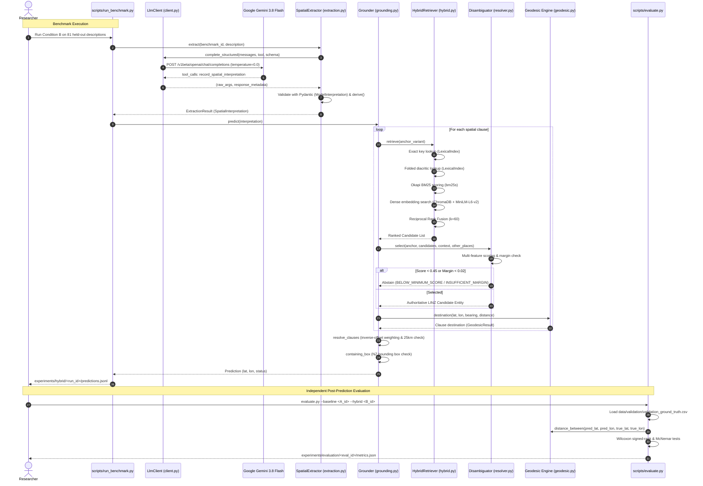

# System Architecture and Execution Flow

This document details the software architecture, component responsibilities, data flow, and algorithmic execution path for the natural-language georeferencing research pipeline.

```
+----------------------------------------------------------------------------------------------------+
|                                    INPUT LOCALITY DESCRIPTION                                      |
+----------------------------------------------------------------------------------------------------+
                                                  |
                         +------------------------+------------------------+
                         |                                                 |
                         v                                                 v
           [ CONDITION A: STANDALONE LLM ]                   [ CONDITION B: HYBRID PIPELINE ]
           Gemini 3.8 Flash (Greedy Decoding)                 Gemini 3.8 Flash (Structured Extraction)
                         |                                                 |
                         v                                                 v
             `record_coordinates` Tool                         `record_spatial_interpretation` Tool
                         |                                                 |
                         v                                                 v
               Latitude & Longitude                            Parsed Spatial Clauses
                         |                                                 |
                         |                                                 v
                         |                                     Multi-Channel Gazetteer Retrieval
                         |                                     (Exact | Folded | BM25 | Dense)
                         |                                                 |
                         |                                                 v
                         |                                        Reciprocal Rank Fusion
                         |                                                 |
                         |                                                 v
                         |                                     Deterministic Disambiguation
                         |                                     (Weighted Multi-Feature Scoring)
                         |                                                 |
                         |                                                 v
                         |                                         LINZ Anchor Entity
                         |                                                 |
                         |                                                 v
                         |                                     Direct WGS84 Geodesic Solution
                         |                                     (GeographicLib / Karney)
                         |                                                 |
                         |                                                 v
                         |                                     Multi-Anchor Clause Resolution
                         |                                     (Inverse-Offset Fusion / Checks)
                         |                                                 |
                         |                                                 v
                         |                                     Coordinate Sanity Bounding Boxes
                         |                                                 |
                         +------------------------+------------------------+
                                                  |
                                                  v
                                     [ PREDICTED COORDINATES ]
                                                  |
                                                  v
                                     [ CONDITION C ARBITRATION ]
                                     (Deterministic Agreement @ 25 km)
                                                  |
                                                  v
                                         ---- FREEZE GATE ----
                                                  |
                                                  v
                                    [ EVALUATION & STATISTICS ]
                                    (Held-out Ground Truth, Geodesic Error,
                                     Wilcoxon Signed-Rank, McNemar Tests)
```

---

## 1. System Overview and Core Design Principles

The architecture enforces a strict foundational principle:

> **"The language model interprets; deterministic Python computes."**

1. **Non-Agentic Serialisation Contract:** The LLM is never given interactive tool access to search the gazetteer, evaluate candidate coordinates, or compute destination points. Such autonomy would make intermediate failures non-reproducible and unattributable. Instead, OpenAI-compatible tool calling is used purely as a rigid JSON serialisation mechanism.
2. **Hermetic Architectural Isolation:** Condition A is strictly isolated from geographic knowledge bases, gazetteer records, and geodesic algorithms. This boundary is mechanically enforced by automated Abstract Syntax Tree (AST) unit tests (`tests/isolation/test_condition_a_isolation.py`).
3. **Strict Evaluation Boundary:** Prediction scripts (`scripts/run_benchmark.py`, `scripts/extract_dev.py`, `scripts/build_index.py`) are strictly prohibited from referencing or reading ground-truth coordinate datasets (`tests/isolation/test_no_ground_truth_leakage.py`). Ground truth is accessed solely inside `scripts/evaluate.py` after predictions have completed.
4. **Explicit Abstention:** In Condition B, abstention is a first-class outcome rather than an uncaught exception. When candidate confidence is low ($< 0.45$), candidate margins are ambiguous ($< 0.02$), clauses conflict ($> 25\text{ km}$), or predicted coordinates lie outside New Zealand bounds, the pipeline abstains with a structured status code.

---

## 2. End-to-End Execution Flow

### 2.1 Complete Pipeline Sequence Diagram



---

## 3. Component Architecture and Detailed Responsibilities

### 3.1 Configuration Layer (`configs/`)
Centralized YAML specifications define all parameters, ensuring zero magic numbers exist in source code:
- [`benchmark.yaml`](file:///c:/Users/sahil/Desktop/dissertation-georef-clean/configs/benchmark.yaml): Regex eligibility filter, coordinate rounding tolerances, bounding boxes, sampling seeds.
- [`apis.yaml`](file:///c:/Users/sahil/Desktop/dissertation-georef-clean/configs/apis.yaml): Service URLs, API key environment variable names, timeouts, retry policies, worker limits.
- [`models.yaml`](file:///c:/Users/sahil/Desktop/dissertation-georef-clean/configs/models.yaml): LLM profiles (`gemini_flash`, `nvidia_gpt_oss`), embedding model (`all-MiniLM-L6-v2`), reranker (`bge-reranker-v2-m3`).
- [`retrieval.yaml`](file:///c:/Users/sahil/Desktop/dissertation-georef-clean/configs/retrieval.yaml): Channel enablement, top-$k$ allocations, document formatting template, RRF constant ($k=60$).
- [`disambiguation.yaml`](file:///c:/Users/sahil/Desktop/dissertation-georef-clean/configs/disambiguation.yaml): Weights for name, rank, feature type, district, and spatial coherence; minimum score (0.45) and margin (0.02) thresholds.
- [`pipeline.yaml`](file:///c:/Users/sahil/Desktop/dissertation-georef-clean/configs/pipeline.yaml): Multi-anchor resolution policies (`first`, `shortest`, `fuse`), disagreement ceiling (25 km), New Zealand bounding boxes.
- [`condition_c.yaml`](file:///c:/Users/sahil/Desktop/dissertation-georef-clean/configs/condition_c.yaml): Arbitration strategy (`agreement` @ 25 km) selected from dev/benchmark sweep.
- [`paths.yaml`](file:///c:/Users/sahil/Desktop/dissertation-georef-clean/configs/paths.yaml): Directory paths and file identifiers for datasets, ground truth, and cache assets.

### 3.2 LLM Interaction Layer (`src/georef/llm/`)
- [`client.py`](file:///c:/Users/sahil/Desktop/dissertation-georef-clean/src/georef/llm/client.py) (`LlmClient`):
  - Wraps the OpenAI Python SDK pointing to Gemini (`https://generativelanguage.googleapis.com/v1beta/openai/`).
  - Implements custom retry logic with exponential backoff and randomized jitter (2.0s).
  - Handles structured output enforcement through forced tool calling.
  - Returns `LlmResponse` with full audit provenance (requested model, served model, token usage, latency, attempt count).
- [`baseline.py`](file:///c:/Users/sahil/Desktop/dissertation-georef-clean/src/georef/llm/baseline.py) (`BaselineGeoreferencer`):
  - Condition A implementation.
  - Sends description to Gemini with `BASELINE_PROMPT` (`baseline-v1`).
  - Parses coordinates via Pydantic model `BaselineCoordinates`.
- [`extraction.py`](file:///c:/Users/sahil/Desktop/dissertation-georef-clean/src/georef/llm/extraction.py) (`SpatialExtractor`):
  - Condition B interpretation stage.
  - Sends description with `SYSTEM_PROMPT` (`extract-v5`).
  - Parses clauses via Pydantic model `ModelInterpretation`.
  - Normalizes text via [`normalise.py`](file:///c:/Users/sahil/Desktop/dissertation-georef-clean/src/georef/normalise.py).

### 3.3 Semantic Data Models (`src/georef/models/spatial.py`)
- `SpatialClause`: Captures anchor entity string, raw distance value, distance unit, direction text, and hedge flags.
  - Validates and parses numbers from hedged strings (`"ca. 3"` $\to 3.0$), fractions (`"1/2 mile"` $\to 0.5$), and ranges (`"10-12 km"` $\to 11.0$).
- `DerivedClause`: Augments `SpatialClause` with deterministically derived true bearing in degrees and distance in metres.
- `ModelInterpretation`: Description-level structure capturing relation type, clause list, wider geographic context, ambiguity flag, and self-reported confidence.
- `SpatialInterpretation`: Complete semantic payload containing derived clauses and provenance metadata.

### 3.4 Multi-Channel Retrieval Layer (`src/georef/retrieval/`)
- [`lexical.py`](file:///c:/Users/sahil/Desktop/dissertation-georef-clean/src/georef/retrieval/lexical.py) (`LexicalIndex`):
  - In-memory data store holding all 49,771 LINZ gazetteer records.
  - **Exact Channel:** Matches canonicalized string key (`normalise()`).
  - **Folded Channel:** Matches diacritic-stripped string key (`match_key()`).
  - **BM25 Channel:** BM25 retrieval using `bm25s` over document string `"{name} | {feature_type} | {land_district} | New Zealand"`.
- [`dense.py`](file:///c:/Users/sahil/Desktop/dissertation-georef-clean/src/georef/retrieval/dense.py) (`ChromaVectorStore` & `SentenceTransformerEmbedder`):
  - Persistent ChromaDB collection (`nz_geographic_entities`).
  - Embeds queries using `sentence-transformers/all-MiniLM-L6-v2` (384 dimensions, cosine distance).
- [`candidates.py`](file:///c:/Users/sahil/Desktop/dissertation-georef-clean/src/georef/retrieval/candidates.py):
  - Merges ranked lists using **Reciprocal Rank Fusion**:
    $$\text{RRF\_Score}(d) = \sum_{c \in \text{channels}} \frac{1}{60 + \text{rank}_c(d)}$$
  - Breaks score ties deterministically by ascending integer `linz_id`.
- [`name_spotter.py`](file:///c:/Users/sahil/Desktop/dissertation-georef-clean/src/georef/retrieval/name_spotter.py) (`NameSpotter`):
  - Extracts other New Zealand proper place names from description text to serve as geographic context anchors for spatial coherence scoring.

### 3.5 Disambiguation & Entity Resolution (`src/georef/disambiguation/`)
- [`anchors.py`](file:///c:/Users/sahil/Desktop/dissertation-georef-clean/src/georef/disambiguation/anchors.py):
  - Generates query forms: literal, bracket-stripped, qualifier-stripped (`anchor_variants`).
  - Identifies generic-only anchors (`"the bridge"`, `"the hut"`).
  - Matches feature types implied by anchor generic words (e.g. `"River"` $\to$ River/Stream).
- [`resolver.py`](file:///c:/Users/sahil/Desktop/dissertation-georef-clean/src/georef/disambiguation/resolver.py) (`Disambiguator`):
  - Evaluates candidates using a normalized weighted multi-feature sum:
    - Exact Name Match ($1.0$)
    - Folded Name Match ($0.9$)
    - Distinctive Name Token Similarity ($0.8$)
    - Feature Type Alignment ($0.7$)
    - Regional Context Agreement ($0.6$)
    - Spatial Coherence with Other Mentioned Entities ($0.9$)
    - Retrieval Rank Decay ($0.25$)
    - Geometry Type Point Prior ($0.2$)
    - Official Status Prior ($0.15$)
  - **Abstention Criteria:**
    - Rejects top candidate if normalized score $< 0.45$ (`BELOW_MINIMUM_SCORE`).
    - Rejects top candidate if difference between rank 1 and rank 2 $< 0.02$ (`INSUFFICIENT_MARGIN`), unless both candidates lie within 2,000 metres of each other (spatial agreement).

### 3.6 Geodesic Calculations & Coordinate Handling (`src/georef/spatial/`)
- [`units.py`](file:///c:/Users/sahil/Desktop/dissertation-georef-clean/src/georef/spatial/units.py):
  - Converts 16-point compass directions (`"N"`, `"NNE"`, ..., `"NW"`, `"NNW"`) into clockwise degrees from true north.
  - Converts distance units (`"km"`, `"m"`, `"miles"`, `"mls"`, `"ft"`, `"yd"`) to SI metres.
- [`geodesic.py`](file:///c:/Users/sahil/Desktop/dissertation-georef-clean/src/georef/spatial/geodesic.py):
  - Solves ellipsoidal direct problem via `Geodesic.WGS84.Direct(lat1, lon1, azi1, s12)`.
  - Solves ellipsoidal inverse problem via `Geodesic.WGS84.Inverse(lat1, lon1, lat2, lon2)`.
  - Wraps longitude strictly to $[-180.0, +180.0)$.
  - Interpolates intermediate coordinates along geodesic curves via `Geodesic.WGS84.InverseLine`.
- [`resolution.py`](file:///c:/Users/sahil/Desktop/dissertation-georef-clean/src/georef/spatial/resolution.py):
  - Resolves multi-clause descriptions using policy `fuse`:
    $$w_i = \frac{1}{\max(\text{offset}_i, 100\text{ m})}, \quad \text{fraction} = \frac{w_2}{w_1 + w_2}$$
  - Evaluates geodesic disagreement between clause estimates; abstains if disagreement exceeds 25,000 metres (`CLAUSE_DISAGREEMENT`).
- [`bounds.py`](file:///c:/Users/sahil/Desktop/dissertation-georef-clean/src/georef/spatial/bounds.py):
  - Checks coordinate containment inside New Zealand mainland, Chatham Islands (negative longitudes), and offshore bounding boxes.

### 3.7 Evaluation and Statistical Analysis (`src/georef/evaluation/`)
- [`metrics.py`](file:///c:/Users/sahil/Desktop/dissertation-georef-clean/src/georef/evaluation/metrics.py):
  - Computes WGS84 geodesic error in kilometres (`geodesic_error_km`).
  - Summarizes coverage, mean error, median error, p90 error, and threshold proportions ($\le 1\text{ km}$, $\le 5\text{ km}$, $> 50\text{ km}$).
- [`statistics.py`](file:///c:/Users/sahil/Desktop/dissertation-georef-clean/src/georef/evaluation/statistics.py):
  - Implements exact paired two-sided Wilcoxon signed-rank test over paired valid predictions.
  - Implements exact two-sided McNemar test over paired threshold binary outcomes.
  - Explicitly documents and reports denominators for all comparisons.
